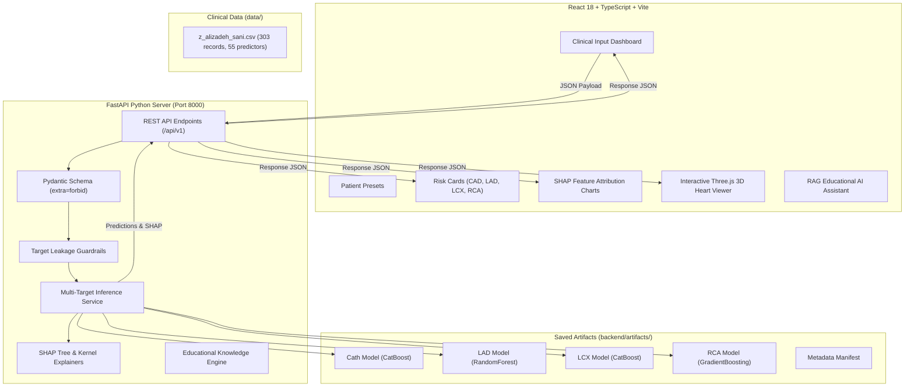

# CARDIOVISION X — Technical System Architecture

## Overview Architecture Diagram

## Component Breakdown

1. **Frontend Layer:**
   - Framework: React 18, TypeScript, Vite, Tailwind CSS.
   - 3D Rendering: Three.js, React Three Fiber, Drei, WebGL.
   - Data Visualization: Recharts (SHAP horizontal bar charts, global importance, metrics).
   - Icons & Components: Lucide React.

2. **Backend API Layer:**
   - Framework: FastAPI, Uvicorn, Pydantic v2.
   - Guardrails: Strict Pydantic `extra="forbid"` and `leakage_checks.py` module.

3. **Machine Learning Pipeline:**
   - Library: scikit-learn, CatBoost, XGBoost, Joblib, SHAP.
   - Data Processing: Imputation, Standard Scaling, One-Hot Encoding, Stratified 80/20 train-test splits.
